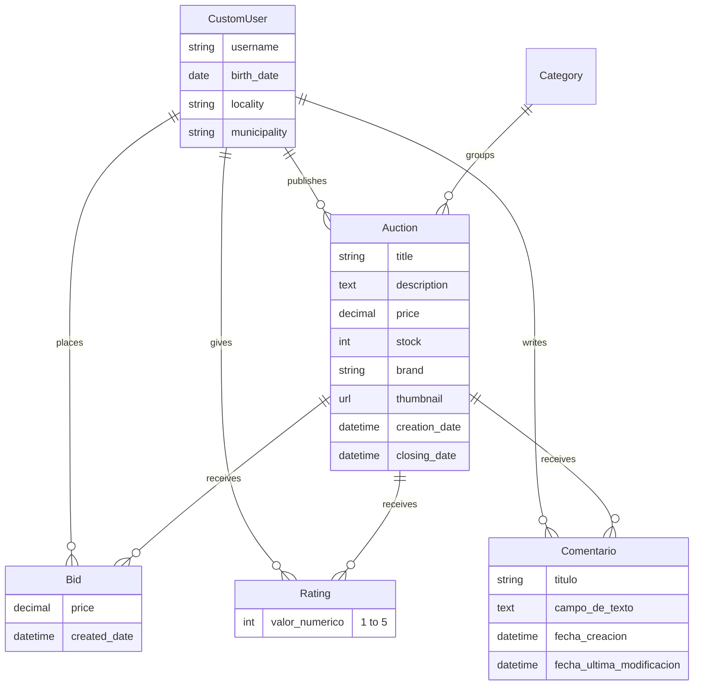

# Auction API · Django REST Framework


REST backend for an online auction platform. Users register, publish auctions, place bids, rate items and
leave comments. Access is controlled with JWT authentication and object-level permissions.

Built as the final project of a backend development course at Universidad Pontificia Comillas (ICAI),
spring 2025.

## Features

- **JWT authentication** with access/refresh tokens, refresh rotation and logout via token blacklisting
  (`djangorestframework-simplejwt`).
- **Custom user model** (`users.CustomUser`) with registration, profile view/update/delete and password change.
- **Auctions** with search, filtering and business rules:
  - full-text search over title and description (`?search=`, minimum 3 characters)
  - filters by category, price range (`priceMin`, `priceMax`), minimum average rating (`rating`) and
    open/closed state (`is_open`)
  - the closing date must be in the future and at least 15 days after creation
- **Bids** that must beat the current highest bid of the auction.
- **Ratings** (1–5) and **comments**, one of each per user and auction. The average rating is computed on the fly.
- **Object-level permissions**: only the owner (or an admin) can edit or delete an auction, bid, rating or
  comment. Categories are admin-managed and read-only for everyone else.
- **OpenAPI schema and Swagger UI** generated with `drf-spectacular`.
- Pagination (20 items per page) and CORS enabled for a separate frontend.

## Data model



## API overview

All routes are prefixed with `/api/`. Interactive docs are available at **`/api/docs/`** once the server is running.

| Area | Method & route | Access |
|---|---|---|
| Auth | `POST token/` · `POST token/refresh/` | Public |
| Users | `POST users/register/` | Public |
| | `GET PATCH DELETE users/profile/` · `POST users/change-password/` · `POST users/log-out/` | Authenticated |
| | `GET users/` · `GET PUT PATCH DELETE users/<id>/` | Admin |
| Categories | `GET POST auctions/categories/` · `GET PUT PATCH DELETE auctions/categories/<id>/` | Read: public · Write: admin |
| Auctions | `GET POST auctions/` · `GET PUT PATCH DELETE auctions/<id>/` | Read: public · Write: owner/admin |
| Bids | `GET POST auctions/<id>/bid/` · `GET PUT PATCH DELETE auctions/<id>/bid/<bid_id>/` | Read: public · Write: owner/admin |
| Ratings | `GET POST auctions/<id>/ratings/` · `GET PUT PATCH DELETE auctions/<id>/ratings/<rating_id>/` | Read: public · Write: owner/admin |
| Comments | `GET POST auctions/<id>/comments` · `GET PUT PATCH DELETE auctions/<id>/comments/<comment_id>` | Read: public · Write: owner/admin |
| My activity | `GET auctions/users/` · `GET auctions/users/ratings` · `GET auctions/users/comments` | Authenticated |

Example query:

```http
GET /api/auctions/?search=laptop&category=2&priceMin=100&priceMax=800&rating=4&is_open=true
```

## Getting started

```bash
git clone https://github.com/bernigomez644/auction-api-django.git
cd auction-api-django

python -m venv .venv
source .venv/bin/activate        # Windows: .venv\Scripts\activate
pip install -r requirements.txt

cd myApiFinalProyect
python manage.py migrate
python manage.py createsuperuser  # optional, to manage categories and use /admin
python manage.py runserver
```

Then open <http://127.0.0.1:8000/api/docs/>.

For anything beyond local development, set `DJANGO_SECRET_KEY` and `DJANGO_DEBUG=False` as environment variables.

## Project structure

```
myApiFinalProyect/
├── myApiFinalProyect/   # settings, root URLs (JWT + OpenAPI routes), WSGI/ASGI
├── auctions/            # categories, auctions, bids, ratings, comments
│   ├── models.py
│   ├── serializers.py   # validation rules (closing date, bid amount…)
│   ├── permissions.py   # owner-or-admin object permissions
│   ├── views.py         # generic DRF views + search/filter logic
│   └── urls.py
└── users/               # custom user model, registration, profile, logout, password change
```

## Tech stack

Python · Django 5.2 · Django REST Framework · Simple JWT · drf-spectacular · django-cors-headers · SQLite
